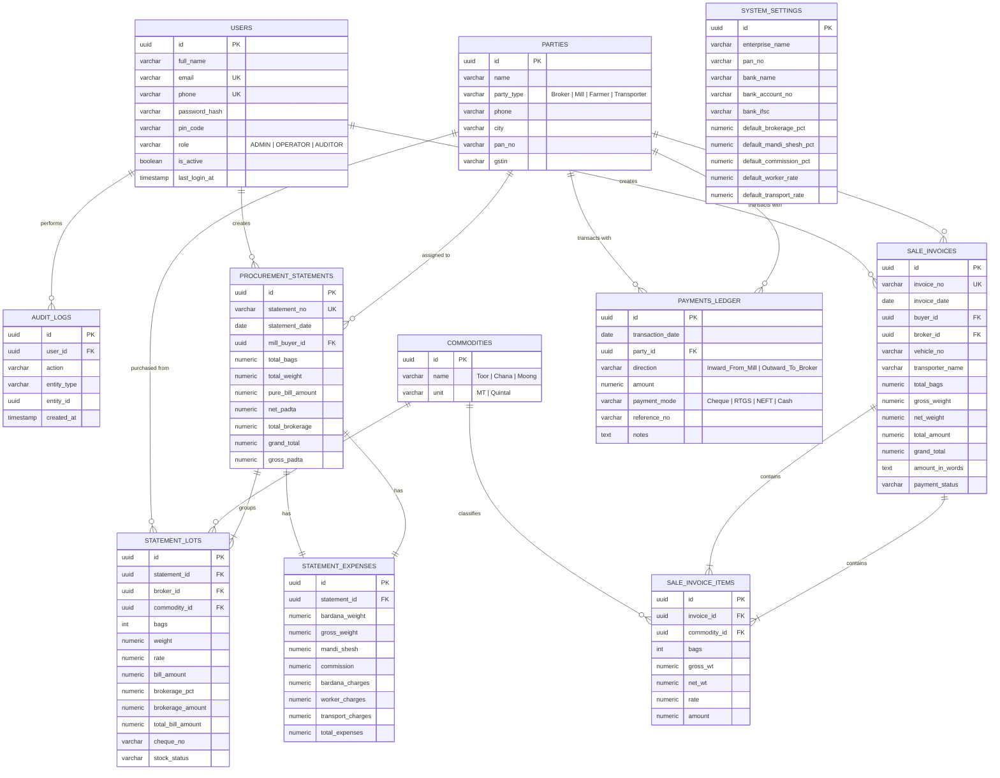

# R. MAHAJAN ENTERPRISE
## Grain Trading, Procurement & Billing Management System (ERP)
### Complete Architectural Blueprint, Technical Specification & Cloud Deployment Guide

---

## Table of Contents
1. [Business Background & Operational Context](#1-business-background--operational-context)
2. [Deep Analysis & Reverse-Engineering of Both Excel Sheets](#2-deep-analysis--reverse-engineering-of-both-excel-sheets)
   - [2.1 Buying / Mandi Statement Sheet (Inward Procurement & Padta Engine)](#21-buying--mandi-statement-sheet-inward-procurement--padta-engine)
   - [2.2 Selling Record / Bill Generation Sheet (Outward Sale Invoice)](#22-selling-record--bill-generation-sheet-outward-sale-invoice)
3. [Complete Mathematical Formulas & Business Logic](#3-complete-mathematical-formulas--business-logic)
4. [Cloud Hosting Architecture & Anywhere Access Strategy](#4-cloud-hosting-architecture--anywhere-access-strategy)
   - [4.1 Database Hosting (Supabase PostgreSQL)](#41-database-hosting-supabase-postgresql)
   - [4.2 Web & Mobile Application Hosting (Vercel)](#42-web--mobile-application-hosting-vercel)
   - [4.3 Mobile Access (Progressive Web App - PWA)](#43-mobile-access-progressive-web-app---pwa)
   - [4.4 Automated Backups & Offline Excel Export](#44-automated-backups--offline-excel-export)
   - [4.5 Admin Authentication, Security & Role-Based Access Control (RBAC)](#45-admin-authentication-security--role-based-access-control-rbac)
5. [Database Schema (PostgreSQL DDL & ER Diagram)](#5-database-schema-postgresql-ddl--er-diagram)
6. [Application Feature Set & Screen-by-Screen Wireframes](#6-application-feature-set--screen-by-screen-wireframes)
   - [Screen 0: Secure Admin & Staff Login](#screen-0-secure-admin--staff-login)
   - [Screen 1: Dashboard & Daily Mandi Summary](#screen-1-dashboard--daily-mandi-summary)
   - [Screen 2: Buying & Mandi Statement Entry (Dynamic Excel-like Grid)](#screen-2-buying--mandi-statement-entry-dynamic-excel-like-grid)
   - [Screen 3: Sale Bill / Tax Invoice Generator](#screen-3-sale-bill--tax-invoice-generator)
   - [Screen 4: Date-Wise Records Archive & Search](#screen-4-date-wise-records-archive--search)
   - [Screen 5: Broker & Mill Khata / Payment Ledger](#screen-5-broker--mill-khata--payment-ledger)
   - [Screen 6: Admin Settings & Configuration Center](#screen-6-admin-settings--configuration-center)
7. [Step-by-Step Implementation & Excel Migration Plan](#7-step-by-step-implementation--excel-migration-plan)

---

## 1. Business Background & Operational Context

* **Enterprise:** R. MAHAJAN ENTERPRISE
* **Business Type:** Grain Merchants, Commission Agents (Aadathiya) & Mandi Traders
* **Commodities Handled:** Toor (Arhar), Chana (Gram), Pulses & Agricultural Produce
* **Location:** Agricultural Produce Market Committee (A.P.M.C.), Saoner - 441107 (District Nagpur, Maharashtra)
* **Proprietor:** Yash Mahajan (Mobile: `+91 9850020793`)
* **PAN Card No.:** `IKGPK7086G`
* **State Code:** `27` (Maharashtra)
* **Primary Bank:** Axis Bank, Saoner Branch | A/c No.: `924020061268613` | IFSC: `UTIB0003817`

### The Day-to-Day Workflow Being Automated:
1. **Morning / Mandi Auction:** Yash Mahajan buys commodity lots brought in by farmers and sub-brokers in the Saoner APMC Mandi.
2. **Afternoon / Consolidation:** The purchased lots are weighed, bagged, and aggregated into a **Statement** assigned to specific Dal Mills (e.g. *Shree Mohan Industries Pvt. Ltd.*, *Pawansut Dall Mill Pvt. Ltd.*, *Saurabh Dall Mill*, *Maira Food Mill*).
3. **Costing & Padta Calculation:** Mandi expenses (Bardana weight, Mandi Cess, Commission, Hamali/labor, and Transport) are calculated to determine the **Net Padta** and **Gross Padta** (true landed cost per Quintal / Ton).
4. **Dispatch & Invoicing:** A formal **Sale Bill** is issued with vehicle number, transporter details, gross/net weight, and bank RTGS/NEFT payment instructions.
5. **Settlement & Ledger:** Cheques and bank transfers are tracked for both brokers (payments out) and mills (payments in).

---

## 2. Deep Analysis & Reverse-Engineering of Both Excel Sheets

### 2.1 Buying / Mandi Statement Sheet (Inward Procurement & Padta Engine)

Based on the 4 procurement statements in your Excel file (`Statement 19/10/2026`, `Shree Mohan Industries 14/10/2026`, `Pawansut Dall Mill 01/08/2026`, and `Saurabh Dall Mill` / `Maira Food Mill` templates):

#### A. Mandi Statement Header
* Title: `R. MAHAJAN ENTERPRISE`
* Subtitle: `Agricultural Product Market Committee, Saoner`
* Contact: `Proprietor : Yash Mahajan | Mob. : 9850020793`
* Statement Identifier: `STATEMENT (<Target Mill / Consignee Name>)`
* Statement Date: `DD/MM/YYYY`

#### B. Individual Broker Purchases (Lots Table)
| Column Name | Excel Representation | Data Type | Behavior / Calculation |
| :--- | :--- | :--- | :--- |
| **No.** | `1, 2, 3...` | Integer | Serial number of lot |
| **Broker's Name** | `Dilip Jain`, `Roshan Chandak`, `Dhonbaji Nirgude`, etc. | Dropdown / Text | Broker or farmer who brought the lot |
| **Bags** | `50`, `115`, etc. | Integer | Number of gunny/poly bags in lot |
| **Weight** | `6.535`, `5.46`, `1.775`, `28.275` | Decimal (3-4 places) | Lot weight in Metric Tonnes (MT) or Quintals |
| **Rate** | Calculated or Input (e.g. `10,200`) | Decimal | Purchase price per unit weight |
| **Bill Amount** | `18,105.00`, `2,24,277.30` | Currency | $\text{Weight} \times \text{Rate}$ |
| **Brokerage** | `271.58`, `3,364.16` | Currency | Fixed at **1.5%** (`Bill Amount × 0.015`) |
| **Total Bill Amount** | `18,376.58`, `2,27,641.46` | Currency | $\text{Bill Amount} + \text{Brokerage}$ |
| **Check No.** | e.g. `CHQ 441029` / UTR | Text | Payment tracking number for broker |
| **Stock** | Text / Flag | Text | In-Stock / Dispatched / Weighbridge verified |

#### C. Totals & Net Padta
* **Total Weight:** $\sum \text{Lot Weights}$ (e.g., `67.41`, `7.51`, `32.825`)
* **Total Bill Amount:** $\sum \text{Lot Bill Amounts}$ (e.g., `₹4,69,675.66`, `₹76,896.72`)
* **Total Brokerage:** $\sum \text{Lot Brokerages}$ (e.g., `₹7,045.13`, `₹1,153.45`)
* **Total Purchase Cost:** $\sum \text{Total Bill Amounts}$ (e.g., `₹4,76,720.79`, `₹78,050.17`)
* **Net Padta (Base Purchase Cost per Unit):**
  $$\text{Net Padta} = \frac{\text{Total Bill Amount}}{\text{Total Weight}}$$
  *(e.g., in Shree Mohan statement: $76,896.72 / 7.51 = \mathbf{₹10,239.24}$)*

#### D. Mandi Expenses & Gross Padta Engine
These operational and statutory expenses are added below the lot table:
1. **Bardana Weight (Gunny Bag Tare):**
   - Standard: `0.6 kg` per bag ($0.0006 \text{ MT}$ or $0.006 \text{ Qtl}$).
   - Formula: $\text{Bardana Wt} = \frac{\text{Total Bags} \times 0.6}{1000}$.
   - **Gross Weight with Bardana:** $\text{Total Weight} + \text{Bardana Wt}$.
2. **Mandi Shesh (Agricultural Market Cess):**
   - Standard Rate: **1.05%** (`0.0105`) of Total Bill Amount.
   - Example: $76,896.72 \times 0.0105 = \mathbf{₹807.42}$.
3. **Commission (Aadath / Trading Commission):**
   - Standard Rate: **1.0% to 1.5%** (`0.01` to `0.015`) of Total Bill Amount.
   - Example (Shree Mohan): $76,896.72 \times 0.015 = \mathbf{₹1,153.45}$.
   - Example (Pawansut): $2,59,999.35 \times 0.01 = \mathbf{₹2,599.99}$.
4. **Bardana Charges (Bag Purchase / Packaging Fee):**
   - Rate: e.g. **₹25 per bag** (Pawansut: $50.49 \times 25 = \mathbf{₹1,262.31}$).
5. **Worker Charges (Hamali / Mandi Labour & Loading):**
   - Standard Rate: **₹14 per unit/bag**.
   - Example (Shree Mohan): $115.538 \times 14 = \mathbf{₹1,617.54}$.
   - Example (Pawansut): $50.49 \times 14 = \mathbf{₹706.89}$.
6. **Transportation Charges (Bhada / Freight):**
   - Standard Rate: **₹40 to ₹45 per unit/ton**.
   - Example (Shree Mohan): $7.5793 \times 40 = \mathbf{₹303.17}$.
   - Example (Pawansut): $33.128 \times 45 = \mathbf{₹1,490.76}$.
7. **Total Mandi Expenses:**
   $$\text{Total Expenses} = \text{Mandi Shesh} + \text{Commission} + \text{Bardana Charges} + \text{Worker Charges} + \text{Transport}$$
8. **Grand Total:**
   $$\text{Grand Total} = \text{Purchases Total} + \text{Total Mandi Expenses}$$
9. **Gross Padta (Total Landed Cost per Unit):**
   $$\text{Gross Padta} = \frac{\text{Grand Total}}{\text{Gross Weight with Bardana}}$$
   *(e.g., Shree Mohan: $81,931.75 / 7.5793 = \mathbf{₹10,809.90}$; Pawansut: $2,72,689.29 / 33.128 = \mathbf{₹8,307.37}$)*

---

### 2.2 Selling Record / Bill Generation Sheet (Outward Sale Invoice)

Based on the Sale Invoice format in your Excel sheet:

#### A. Invoice Header & Vendor Information
* **Company Name:** R. MAHAJAN ENTERPRISE
* **Business Activity:** GRAIN MERCHANTS OF TOOR, CHANA ETC.
* **Mandi Location:** A.P.M.C. SAONER - 441107
* **Proprietor Details:** Yash Mahajan: `9850020793`
* **PAN No.:** `IKGPK7086G`
* **Maharashtra State Code:** `27`

#### B. Invoice Consignee & Dispatch Metadata
* **Invoice No.:** Auto-generated sequence (e.g. `INV-2026-001`)
* **Date:** e.g. `2026-12-10`
* **Buyer / Consignee:** e.g. `SHREE MOHAN INDUSTRIES Pvt. Ltd., Nagpur`
* **Broker:** e.g. `Suresh Bhai`
* **Vehicle No.:** e.g. `MH 40 CM 8588`
* **Transporter:** Transporter Firm / Driver Contact

#### C. Particulars of Goods Table
| S.No. | Description of Goods | Bags | Gross Wt. | Net Wt. | Rate (₹) | Amount (₹) |
| :---: | :--- | :---: | :---: | :---: | :---: | :---: |
| 1 | Toor | 42 | 27.57 | 27.315 | 10,845.48 | 2,98,978.91 |

* *Gross Weight:* Gross weighbridge reading (e.g. `27.57`).
* *Net Weight Calculation:* Deducts tare bag weight (`27.57 - (42 × 0.006) = 27.318` $\approx$ `27.315`).
* *Amount Calculation:* $\text{Weight} \times \text{Rate} = \mathbf{₹2,98,978.91}$.

#### D. Bottom Summary & Legal Terms
* **TOTAL / Subtotal:** `₹2,98,978.91`
* **GRAND TOTAL (Rounded):** `₹2,98,978/-`
* **Rs. in Words (Indian Format):** Auto-generated (e.g. *"Rupees Two Lakh Ninety-Eight Thousand Nine Hundred Seventy-Eight Only"*).
* **Bank Details for Payment:**
  - Bank: **AXIS BANK**
  - Branch: **SAONER**
  - Account Number: **924020061268613**
  - IFSC Code: **UTIB0003817**
* **Statutory Note:**
  > *"Note: Payment within 10 days otherwise interest @ 24% Per Annum will be charged from the date of the bill. Buyer is responsible to collect the Transporter's Copy at the time of unloading. Subject to Nagpur Jurisdiction."*
* **Signatures:** Buyer's Signature | E. & O. E. | For, R. MAHAJAN ENTERPRISE (Authorised Signatory).

---

## 3. Complete Mathematical Formulas & Business Logic

Here are the exact formulas implemented in code for your application:

```typescript
// 1. Broker Lot Calculation
const billAmount = weight * rate;
const brokerageAmount = billAmount * (brokeragePct / 100); // default 1.5%
const totalLotAmount = billAmount + brokerageAmount;

// 2. Net Padta Calculation (Mandi Purchase Base)
const totalWeight = sum(statementLots.map(l => l.weight));
const totalBillAmount = sum(statementLots.map(l => l.billAmount));
const totalBrokerage = sum(statementLots.map(l => l.brokerageAmount));
const netPadta = totalWeight > 0 ? (totalBillAmount / totalWeight) : 0;

// 3. Mandi Expenses Engine
const totalBags = sum(statementLots.map(l => l.bags));
const bardanaWeight = (totalBags * 0.6) / 1000; // 0.6 kg per bag in MT
const grossWeightWithBardana = totalWeight + bardanaWeight;

const mandiShesh = totalBillAmount * 0.0105; // 1.05%
const commission = totalBillAmount * (commissionPct / 100); // 1.0% or 1.5%
const bardanaCharges = totalBags * bardanaRatePerBag; // e.g. ₹25
const workerCharges = totalBags * workerRatePerBag; // ₹14
const transportationCharges = grossWeightWithBardana * transportRatePerUnit; // ₹40 or ₹45

const totalExpenses = mandiShesh + commission + bardanaCharges + workerCharges + transportationCharges;
const grandTotal = totalBillAmount + totalBrokerage + totalExpenses;

// 4. Gross Padta (Total Landed Cost)
const grossPadta = grossWeightWithBardana > 0 ? (grandTotal / grossWeightWithBardana) : 0;

// 5. Sale Invoice Net Weight
const tareDeduction = (bags * 0.6) / 1000;
const saleNetWeight = saleGrossWeight - tareDeduction;
const saleTotalAmount = saleNetWeight * saleRate; // or saleGrossWeight * saleRate
```

---

## 4. Cloud Hosting Architecture & Anywhere Access Strategy

To achieve your goal of accessing the system **from anywhere (Mandi yard, home, mobile, laptop)** with **automatic date-wise cloud storage** and **₹0 to minimal ongoing cost**, here is the recommended architecture:

```
                      ┌──────────────────────────────────────────────┐
                      │              ANY DEVICE ACCESS               │
                      │  • Android Phone / iPhone (Native PWA Icon)  │
                      │  • Mandi Office Laptop / PC                  │
                      │  • Tablet / iPad at APMC Weighbridge         │
                      └──────────────────────┬───────────────────────┘
                                             │ HTTPS
                                             ▼
                      ┌──────────────────────────────────────────────┐
                      │             APPLICATION HOSTING              │
                      │         Platform: VERCEL (Free Tier)         │
                      │  • Global Edge CDN (Instant loading)         │
                      │  • Next.js 14 Frontend + Serverless APIs     │
                      │  • Automated SSL Certificate (https://)      │
                      │  • Custom domain: mahajanenterprise.in       │
                      │    (or free mahajanenterprise.vercel.app)    │
                      └──────────────────────┬───────────────────────┘
                                             │ Encrypted SQL Connection
                                             ▼
                      ┌──────────────────────────────────────────────┐
                      │            CLOUD DATABASE & STORAGE          │
                      │         Platform: SUPABASE (PostgreSQL)      │
                      │  • Managed PostgreSQL 15 Engine              │
                      │  • Daily Automated Backups                   │
                      │  • Instant Date-Indexed Filtering            │
                      │  • Secure Role-Based Authentication          │
                      │  • Free Tier: 500 MB (10+ years of data)     │
                      └──────────────────────────────────────────────┘
```

### 4.1 Database Hosting: Supabase (PostgreSQL)
* **What it is:** The world's most trusted relational database (PostgreSQL), fully managed in the cloud with built-in authentication and automated daily backups.
* **Why it's best for Mahajan Enterprise:**
  - Date queries are lightning fast (e.g. *"Show all Toor purchases between 01-Aug-2026 and 31-Oct-2026"* executes in 15 milliseconds).
  - High reliability: Your data is never lost if your computer crashes or your phone is replaced.
  - **Cost:** Free tier includes 500 MB database storage, 50,000 monthly active users, and unlimited API requests.

### 4.2 Web & API Hosting: Vercel
* **What it is:** Cloud platform designed specifically for Next.js and modern web applications.
* **Why it's best:**
  - Deploy once with GitHub; zero server maintenance, no Linux patching, no port management.
  - 99.99% uptime with global servers.
  - **Cost:** Free tier includes 100 GB bandwidth per month (ample for thousands of daily invoices).

### 4.3 Mobile Access via Progressive Web App (PWA)
* You **do not need** to pay \$99/year to Apple or \$25 to Google to publish on app stores.
* When you open `https://your-domain.com` in Chrome or Safari on your phone, tap **"Add to Home Screen"**.
* It installs directly onto your phone with the **R. Mahajan Enterprise icon**, opens full-screen like a native app, and works seamlessly on 4G/5G in the Mandi.

### 4.4 Automated Backups & Offline Excel Export
* Even though data is stored in the cloud, you will have a **1-Click "Download All to Excel"** button on your dashboard.
* At any time, you can export your entire database into Excel format (`.xlsx`) categorized by Date, Broker, and Mill for peace of mind.

### 4.5 Admin Authentication, Security & Role-Based Access Control (RBAC)

To safeguard confidential financial records, purchase prices, broker settlement balances, and bank details, the system enforces **multi-level security**:

#### A. User Roles & Permissions Matrix
| Feature / Action | Admin (Yash Mahajan) | Staff / Mandi Operator | Auditor / CA (View-Only) |
| :--- | :---: | :---: | :---: |
| **Login via Password / Mobile PIN** | ✅ Full Access | ✅ Operator Access | ✅ Read-Only Access |
| **Record Daily Buying Lots** | ✅ Create / Edit / Delete | ✅ Create / Edit (Today Only) | ❌ No Access |
| **View Net & Gross Padta Margins** | ✅ Visible | ⚠️ Configurable (Hide/Show) | ✅ Visible |
| **Generate & Print Sale Bills** | ✅ Full Access | ✅ Create / Print Bills | ❌ No Access |
| **Edit Bank Details & Axis Bank A/c** | ✅ Full Control | ❌ Denied | ❌ Denied |
| **Configure Mandi Rates (Shesh %, Hamali ₹)**| ✅ Full Control | ❌ Denied | ❌ Denied |
| **Delete Historical Records / Bills** | ✅ Allowed (with Audit Log)| ❌ Strictly Denied | ❌ Denied |
| **Export All Data to Excel** | ✅ Any Date Range | ⚠️ Today's Records Only | ✅ Full History |
| **Manage Users & Passwords** | ✅ Full Control | ❌ Denied | ❌ Denied |

#### B. Quick Mobile Access (4-Digit Mandi PIN)
* When working in the noisy, busy APMC Mandi yard, typing long passwords repeatedly on a phone is cumbersome.
* The system allows Yash Mahajan to set a **4-digit fast PIN** (or Biometric / Fingerprint / Face ID via WebAuthn) for fast 1-second unlocking while retaining 100% cloud security.

#### C. Session Security & Multi-Device Sync
* **Persistent Session:** When Yash Mahajan logs in on his smartphone, the login token stays securely active for 30 days without repeatedly kicking him out.
* **Instant Cloud Lock:** If a phone is lost or misplaced, Yash can revoke all active sessions from any web browser in 1 click.
* **Audit Trails:** Every creation, modification, or cancellation of a bill or statement logs the User ID, Timestamp, and IP Address.

---

## 5. Database Schema (PostgreSQL DDL & ER Diagram)



### Complete Ready-to-Execute SQL Scripts
```sql
-- Create custom extension
CREATE EXTENSION IF NOT EXISTS "uuid-ossp";

-- 0. Admin & Staff Authentication
CREATE TABLE users (
    id UUID PRIMARY KEY DEFAULT uuid_generate_v4(),
    full_name VARCHAR(100) NOT NULL,
    email VARCHAR(150) UNIQUE,
    phone VARCHAR(20) UNIQUE NOT NULL,
    password_hash VARCHAR(255) NOT NULL,
    pin_code VARCHAR(10), -- 4-digit mobile quick-unlock PIN
    role VARCHAR(50) NOT NULL DEFAULT 'OPERATOR' CHECK (role IN ('ADMIN', 'OPERATOR', 'AUDITOR')),
    is_active BOOLEAN DEFAULT TRUE,
    last_login_at TIMESTAMP WITH TIME ZONE,
    created_at TIMESTAMP WITH TIME ZONE DEFAULT NOW()
);

-- Seed initial Admin User (Yash Mahajan)
INSERT INTO users (full_name, phone, email, password_hash, pin_code, role) VALUES
('Yash Mahajan', '9850020793', 'yashmahajan@enterprise.com', '$2b$10$e8K...admin_hash', '1234', 'ADMIN');

-- 0.1 Enterprise Master Settings (Configurable by Admin)
CREATE TABLE system_settings (
    id UUID PRIMARY KEY DEFAULT uuid_generate_v4(),
    enterprise_name VARCHAR(255) DEFAULT 'R. MAHAJAN ENTERPRISE',
    tagline VARCHAR(255) DEFAULT 'GRAIN MERCHANTS OF TOOR, CHANA ETC.',
    apmc_address TEXT DEFAULT 'A.P.M.C. SAONER - 441107',
    proprietor_name VARCHAR(100) DEFAULT 'Yash Mahajan',
    contact_phone VARCHAR(20) DEFAULT '9850020793',
    pan_no VARCHAR(20) DEFAULT 'IKGPK7086G',
    state_code VARCHAR(10) DEFAULT '27',
    bank_name VARCHAR(100) DEFAULT 'AXIS BANK',
    bank_branch VARCHAR(100) DEFAULT 'SAONER',
    bank_account_no VARCHAR(50) DEFAULT '924020061268613',
    bank_ifsc VARCHAR(20) DEFAULT 'UTIB0003817',
    default_brokerage_pct NUMERIC(6, 2) DEFAULT 1.50,
    default_mandi_shesh_pct NUMERIC(6, 4) DEFAULT 0.0105,
    default_commission_pct NUMERIC(6, 4) DEFAULT 0.0150,
    default_worker_rate NUMERIC(10, 2) DEFAULT 14.00,
    default_transport_rate NUMERIC(10, 2) DEFAULT 40.00,
    default_bardana_tare_kg NUMERIC(6, 3) DEFAULT 0.600,
    updated_at TIMESTAMP WITH TIME ZONE DEFAULT NOW()
);

INSERT INTO system_settings (enterprise_name) VALUES ('R. MAHAJAN ENTERPRISE');

-- 0.2 Audit Log (Tracks every transaction by user)
CREATE TABLE audit_logs (
    id UUID PRIMARY KEY DEFAULT uuid_generate_v4(),
    user_id UUID REFERENCES users(id),
    action VARCHAR(100) NOT NULL, -- 'LOGIN', 'CREATE_STATEMENT', 'UPDATE_INVOICE', 'DELETE_RECORD'
    entity_type VARCHAR(50),      -- 'procurement_statements', 'sale_invoices'
    entity_id UUID,
    ip_address VARCHAR(50),
    created_at TIMESTAMP WITH TIME ZONE DEFAULT NOW()
);

-- 1. Master Parties Table (Brokers, Farmers, Dall Mills, Transporters)
CREATE TABLE parties (
    id UUID PRIMARY KEY DEFAULT uuid_generate_v4(),
    name VARCHAR(255) NOT NULL,
    party_type VARCHAR(50) NOT NULL CHECK (party_type IN ('Broker', 'Mill', 'Farmer', 'Transporter')),
    phone VARCHAR(20),
    city VARCHAR(100) DEFAULT 'Saoner',
    state VARCHAR(50) DEFAULT 'Maharashtra',
    state_code VARCHAR(10) DEFAULT '27',
    pan_no VARCHAR(20),
    created_at TIMESTAMP WITH TIME ZONE DEFAULT NOW()
);

-- Seed initial known parties from your Excel sheets
INSERT INTO parties (name, party_type, city) VALUES
('Dhonbaji Nirgude', 'Broker', 'Saoner'),
('Dilip Jain', 'Broker', 'Saoner'),
('Vikrant Rokade', 'Broker', 'Saoner'),
('Chandrashekhar Wath', 'Broker', 'Saoner'),
('Ramesh Mouje', 'Broker', 'Saoner'),
('Bhavrao Gonmare', 'Broker', 'Saoner'),
('Jagdish Thakare', 'Broker', 'Saoner'),
('Roshan Chandak', 'Broker', 'Saoner'),
('Suresh Bhai', 'Broker', 'Saoner'),
('SHREE MOHAN INDUSTRIES Pvt. Ltd.', 'Mill', 'Nagpur'),
('Pawansut Dall Mill pvt ltd.', 'Mill', 'Saoner'),
('Saurabh Dall Mill', 'Mill', 'Saoner'),
('Maira Food Mill', 'Mill', 'Saoner');

-- 2. Master Commodities Table
CREATE TABLE commodities (
    id UUID PRIMARY KEY DEFAULT uuid_generate_v4(),
    name VARCHAR(100) NOT NULL UNIQUE,
    default_unit VARCHAR(20) DEFAULT 'Quintal'
);

INSERT INTO commodities (name, default_unit) VALUES
('Toor', 'Quintal'),
('Chana', 'Quintal');

-- 3. Inward Procurement Statements (Daily Buying Consolidation)
CREATE TABLE procurement_statements (
    id UUID PRIMARY KEY DEFAULT uuid_generate_v4(),
    statement_no VARCHAR(50) UNIQUE NOT NULL,
    statement_date DATE NOT NULL,
    mill_buyer_id UUID REFERENCES parties(id),
    total_bags INT DEFAULT 0,
    total_weight NUMERIC(12, 4) DEFAULT 0,
    pure_bill_amount NUMERIC(14, 2) DEFAULT 0,
    total_brokerage NUMERIC(14, 2) DEFAULT 0,
    total_purchase_amount NUMERIC(14, 2) DEFAULT 0,
    net_padta NUMERIC(12, 2) DEFAULT 0,
    bardana_tare_rate NUMERIC(6, 3) DEFAULT 0.600, -- 0.6 kg
    bardana_weight NUMERIC(12, 4) DEFAULT 0,
    gross_weight NUMERIC(12, 4) DEFAULT 0,
    mandi_shesh_pct NUMERIC(6, 4) DEFAULT 0.0105, -- 1.05%
    mandi_shesh_amount NUMERIC(14, 2) DEFAULT 0,
    commission_pct NUMERIC(6, 4) DEFAULT 0.0150, -- 1.5%
    commission_amount NUMERIC(14, 2) DEFAULT 0,
    bardana_charge_rate NUMERIC(10, 2) DEFAULT 0, -- e.g. 25
    bardana_charges NUMERIC(14, 2) DEFAULT 0,
    worker_charge_rate NUMERIC(10, 2) DEFAULT 14.00, -- 14/bag
    worker_charges NUMERIC(14, 2) DEFAULT 0,
    transport_charge_rate NUMERIC(10, 2) DEFAULT 40.00, -- 40/unit
    transport_charges NUMERIC(14, 2) DEFAULT 0,
    total_expenses NUMERIC(14, 2) DEFAULT 0,
    grand_total NUMERIC(14, 2) DEFAULT 0,
    gross_padta NUMERIC(12, 2) DEFAULT 0,
    notes TEXT,
    created_at TIMESTAMP WITH TIME ZONE DEFAULT NOW()
);

-- 4. Inward Statement Lots (Sub-Broker / Farmer Line Items)
CREATE TABLE statement_lots (
    id UUID PRIMARY KEY DEFAULT uuid_generate_v4(),
    statement_id UUID NOT NULL REFERENCES procurement_statements(id) ON DELETE CASCADE,
    broker_id UUID NOT NULL REFERENCES parties(id),
    commodity_id UUID REFERENCES commodities(id),
    bags INT DEFAULT 0,
    weight NUMERIC(12, 4) NOT NULL,
    rate NUMERIC(12, 2) NOT NULL,
    bill_amount NUMERIC(14, 2) NOT NULL,
    brokerage_pct NUMERIC(6, 2) DEFAULT 1.50,
    brokerage_amount NUMERIC(14, 2) NOT NULL,
    total_bill_amount NUMERIC(14, 2) NOT NULL,
    cheque_no VARCHAR(100),
    stock_status VARCHAR(50) DEFAULT 'Cleared',
    created_at TIMESTAMP WITH TIME ZONE DEFAULT NOW()
);

-- 5. Outward Sale Invoices (Mill Bills)
CREATE TABLE sale_invoices (
    id UUID PRIMARY KEY DEFAULT uuid_generate_v4(),
    invoice_no VARCHAR(50) UNIQUE NOT NULL,
    invoice_date DATE NOT NULL,
    buyer_id UUID NOT NULL REFERENCES parties(id),
    broker_id UUID REFERENCES parties(id),
    vehicle_no VARCHAR(50),
    transporter_name VARCHAR(150),
    total_bags INT DEFAULT 0,
    gross_weight NUMERIC(12, 4) DEFAULT 0,
    net_weight NUMERIC(12, 4) DEFAULT 0,
    total_amount NUMERIC(14, 2) DEFAULT 0,
    grand_total NUMERIC(14, 2) DEFAULT 0,
    amount_in_words TEXT,
    payment_terms_days INT DEFAULT 10,
    interest_rate_annual NUMERIC(5, 2) DEFAULT 24.00,
    payment_status VARCHAR(50) DEFAULT 'Unpaid' CHECK (payment_status IN ('Unpaid', 'Partial', 'Paid')),
    created_at TIMESTAMP WITH TIME ZONE DEFAULT NOW()
);

-- 6. Outward Sale Items
CREATE TABLE sale_invoice_items (
    id UUID PRIMARY KEY DEFAULT uuid_generate_v4(),
    invoice_id UUID NOT NULL REFERENCES sale_invoices(id) ON DELETE CASCADE,
    commodity_id UUID REFERENCES commodities(id),
    bags INT DEFAULT 0,
    gross_wt NUMERIC(12, 4) NOT NULL,
    net_wt NUMERIC(12, 4) NOT NULL,
    rate NUMERIC(12, 2) NOT NULL,
    amount NUMERIC(14, 2) NOT NULL
);

-- 7. Payment Ledger (Brokers & Mills Khata)
CREATE TABLE payments_ledger (
    id UUID PRIMARY KEY DEFAULT uuid_generate_v4(),
    transaction_date DATE NOT NULL,
    party_id UUID NOT NULL REFERENCES parties(id),
    statement_id UUID REFERENCES procurement_statements(id),
    invoice_id UUID REFERENCES sale_invoices(id),
    transaction_type VARCHAR(20) NOT NULL CHECK (transaction_type IN ('Paid_To_Broker', 'Received_From_Mill')),
    amount NUMERIC(14, 2) NOT NULL,
    payment_mode VARCHAR(50) DEFAULT 'Cheque' CHECK (payment_mode IN ('Cheque', 'RTGS', 'NEFT', 'Cash', 'UPI')),
    reference_no VARCHAR(100),
    bank_name VARCHAR(100) DEFAULT 'AXIS BANK SAONER',
    remarks TEXT,
    created_at TIMESTAMP WITH TIME ZONE DEFAULT NOW()
);

-- High-speed indexes for instantaneous date filtering
CREATE INDEX idx_proc_stmt_date ON procurement_statements(statement_date);
CREATE INDEX idx_sale_inv_date ON sale_invoices(invoice_date);
CREATE INDEX idx_stmt_mill ON procurement_statements(mill_buyer_id);
CREATE INDEX idx_stmt_lots_broker ON statement_lots(broker_id);
CREATE INDEX idx_ledger_party_date ON payments_ledger(party_id, transaction_date);
```

---

## 6. Application Feature Set & Screen-by-Screen Wireframes

### Screen 0: Secure Admin & Staff Login
Designed for mobile phones and desktops with dual login modes (Full Password or Mandi Quick PIN):

```
+--------------------------------------------------------------------------------------------------+
|                                      R. MAHAJAN ENTERPRISE                                       |
|                                 Grain Trading ERP & Mandi Portal                                 |
+--------------------------------------------------------------------------------------------------+
|                                                                                                  |
|                                       [ 🔒 ADMIN LOGIN ]                                         |
|                                                                                                  |
|                       Mobile Number / Email:                                                     |
|                       [ 9850020793                                     ]                         |
|                                                                                                  |
|                       Select Login Method:                                                       |
|                       (●) 4-Digit Quick Mandi PIN      (○) Full Password                         |
|                                                                                                  |
|                       Enter Security PIN:                                                        |
|                       [ ●  ●  ●  ● ]                                                             |
|                                                                                                  |
|                       [   LOG IN TO ENTERPRISE DASHBOARD   ]                                     |
|                                                                                                  |
|                       [✓] Keep me logged in on this phone (30 Days)                              |
|                                                                                                  |
|                       Role: Auto-detected (Yash Mahajan -> PROPRIETOR / ADMIN)                  |
|                                                                                                  |
+--------------------------------------------------------------------------------------------------+
```

### Screen 1: Dashboard & Daily Mandi Summary
* **Top Metric Cards:**
  - **Today's Procurement:** Total Bags & Weight (e.g. `115 Bags | 7.51 MT`)
  - **Today's Net Padta vs. Gross Padta:** e.g. `₹10,239 / ₹10,809`
  - **Today's Sales Invoiced:** e.g. `₹2,98,978`
  - **Pending Cheques / Broker Dues:** Total unsettled lot payments
* **Quick Action Buttons:**
  - `+ New Buying Statement`
  - `+ New Sale Bill`
  - `Export All to Excel`
  - `View Date-Wise Archive`

---

### Screen 2: Buying & Mandi Statement Entry (Dynamic Excel-like Grid)
Designed to match your exact current workflow so you don't miss a beat:

```
+--------------------------------------------------------------------------------------------------+
| R. MAHAJAN ENTERPRISE | APMC Saoner           STATEMENT ENTRY             Date: [ 14/10/2026 📅 ] |
| Dal Mill / Consignee: [ SHREE MOHAN INDUSTRIES ▼ ]                        No: [ STMT-2026-089 ]   |
+--------------------------------------------------------------------------------------------------+
| No. | Broker's Name     | Bags | Weight (MT) | Rate (₹)  | Bill Amt (₹) | Brok (1.5%) | Total Amt (₹) | Cheque No.  |
| 1   | Dilip Jain      ▼ |  50  |   1.775     | 10200.00  |   18,105.00  |    271.58   |   18,376.58   | [ CHQ-102 ] |
| 2   | Roshan Chandak  ▼ |  65  |   5.735     | 10251.39  |   58,791.72  |    881.88   |   59,673.60   | [ Pending ] |
| [+] Add New Broker Row                                                                            |
+--------------------------------------------------------------------------------------------------+
| SUMMARY:  Total Bags: 115   |  Total Weight: 7.510 MT  |  Bill: ₹76,896.72  |  Total: ₹78,050.18  |
| >>> NET PADTA: ₹10,239.24 / MT <<<                                                               |
+--------------------------------------------------------------------------------------------------+
| MANDI CHARGES & EXPENSES (Auto-Calculated):                                                      |
|   • Bardana Tare Wt: [ 0.6 ] kg/bag => 0.069 MT    • Gross Wt with Bardana: 7.579 MT            |
|   • Mandi Shesh (1.05%): ₹807.42                   • Commission (1.50%):   ₹1,153.45             |
|   • Worker Charges (₹14/bag): ₹1,617.54            • Transport (₹40/ton):  ₹303.17               |
|   • Bardana Charges (₹25/bag): ₹0.00                                                              |
|   TOTAL EXPENSES: ₹3,881.58                        GRAND TOTAL: ₹81,931.75                        |
|   >>> GROSS PADTA: ₹10,809.90 / MT <<<                                                            |
+--------------------------------------------------------------------------------------------------+
| [ Save & Archive Statement ]   [ Print Statement Slip ]   [ Download Excel ]                     |
+--------------------------------------------------------------------------------------------------+
```

---

### Screen 3: Sale Bill / Tax Invoice Generator
Matches your APMC Invoice layout with exact bank details and legal declarations:

```
+--------------------------------------------------------------------------------------------------+
| R. MAHAJAN ENTERPRISE                                                                             |
| GRAIN MERCHANTS OF TOOR, CHANA ETC.                                                               |
| A.P.M.C. SAONER - 441107  |  Yash Mahajan: 9850020793                                             |
| PAN No.: IKGPK7086G       |  Maharashtra State Code: 27                                           |
+--------------------------------------------------------------------------------------------------+
| Buyer/Consignee: [ SHREE MOHAN INDUSTRIES Pvt. Ltd. ]      | Date: [ 2026-12-10 📅 ]             |
| Address:         [ Nagpur                           ]      | Broker: [ Suresh Bhai       ]        |
| Transporter:     [ Local Transport                  ]      | Vehicle No.: [ MH 40 CM 8588]        |
+-----+----------------------+-------+-----------+---------+-----------+----------------------------+
| S.N | Description of Goods | Bags  | Gross Wt. | Net Wt. | Rate (₹)  | Amount (₹)                 |
|  1  | Toor                 |  42   |   27.57   |  27.315 | 10845.48  | 2,98,978.91                |
+-----+----------------------+-------+-----------+---------+-----------+----------------------------+
| TOTAL:                                                               | 2,98,978.91                |
| GRAND TOTAL:                                                         | ₹2,98,978/-                |
| Rupees in Words: Two Lakh Ninety-Eight Thousand Nine Hundred Seventy-Eight Only.                  |
+--------------------------------------------------------------------------------------------------+
| Bank Details: AXIS BANK | Branch: SAONER | A/c: 924020061268613 | IFSC: UTIB0003817              |
| Terms: Payment within 10 days, 24% p.a. interest after due date. Subject to Nagpur Jurisdiction.  |
+--------------------------------------------------------------------------------------------------+
| [ Print Official A4 PDF ]   [ Send via WhatsApp ]   [ Mark as Paid ]                             |
+--------------------------------------------------------------------------------------------------+
```

---

### Screen 4: Date-Wise Records Archive & Search
- Filter by:
  - **Date Range:** Single day, this week, this month, or financial year (`2026-27`).
  - **Transaction Type:** Buying Statements vs. Sale Bills.
  - **Party:** Filter by specific Mill (*Shree Mohan*, *Pawansut*, etc.) or Broker (*Dilip Jain*, etc.).
  - **Commodity:** *Toor*, *Chana*.
- Features:
  - Instant live search table.
  - Direct 1-click **Export to Excel** for any filtered view.
  - Ability to click any row to edit or reprint past statements.

---

### Screen 5: Broker & Mill Khata / Payment Ledger
- **Broker Settlement View:**
  - Track payments made to brokers (*Dilip Jain*, *Roshan Chandak*, etc.).
  - View cleared vs. pending cheque numbers and UTR references.
- **Dal Mill Outstanding View:**
  - Track pending invoices from *Shree Mohan Industries*, *Pawansut*, *Saurabh*, *Maira*.
  - View credit period warnings (10-day limit with 24% interest indicator).
- **Payment Entry Modal:**
  - Quick popup to record incoming/outgoing payment: Party, Date, Mode (Cheque/NEFT/Cash), Reference No., Bank, and Amount.

---

### Screen 6: Admin Settings & Configuration Center
*Restricted exclusively to Admin role (Yash Mahajan):*

```
+--------------------------------------------------------------------------------------------------+
| R. MAHAJAN ENTERPRISE               ⚙️ ADMIN CONTROL CENTER                  Logged in: Yash Mahajan |
+--------------------------------------------------------------------------------------------------+
| [ Enterprise Profile ]  [ Mandi Charge Defaults ]  [ Bank Account ]  [ Staff Users ]  [ Security ]|
+--------------------------------------------------------------------------------------------------+
| 1. ENTERPRISE DETAILS:                                                                           |
|    Firm Name: [ R. MAHAJAN ENTERPRISE                          ]                                 |
|    APMC Address: [ A.P.M.C. SAONER - 441107                    ]                                 |
|    PAN Number:   [ IKGPK7086G          ]   Maharashtra State Code: [ 27 ]                        |
|                                                                                                  |
| 2. BANK SETTINGS FOR SALE INVOICES:                                                              |
|    Bank Name: [ AXIS BANK       ]   Branch: [ SAONER                 ]                           |
|    Account No: [ 924020061268613 ]  IFSC:   [ UTIB0003817            ]                           |
|                                                                                                  |
| 3. MANDI COSTING & "PADTA" DEFAULTS:                                                             |
|    Default Brokerage: [ 1.50 ] %    Mandi Shesh (Cess): [ 1.05 ] %   Commission: [ 1.50 ] %      |
|    Worker Charges (Hamali): ₹ [ 14.00 ] / bag   Transport (Bhada): ₹ [ 40.00 ] / unit           |
|    Bardana Tare: [ 0.600 ] kg / bag             Bardana Charge: ₹ [ 25.00 ] / bag               |
|                                                                                                  |
| 4. USER & OPERATOR ACCESS:                                                                       |
|    • Yash Mahajan (9850020793) - [ PROPRIETOR / ADMIN ] - Full Access                            |
|    • Mandi Accountant - [ OPERATOR ] - Can Enter Lots & Print Bills Only                         |
|    [+ Add New Staff Login]                                                                       |
+--------------------------------------------------------------------------------------------------+
| [ Save All Settings ]                     [ Download Full System Backup ]                        |
+--------------------------------------------------------------------------------------------------+
```

---

## 7. Step-by-Step Implementation & Excel Migration Plan

### Phase 1: Database Setup (1 Hour)
1. Sign up at [supabase.com](https://supabase.com).
2. Create project `mahajan-enterprise`.
3. Open the **SQL Editor** tab in Supabase, copy the SQL script from [Section 5](#5-database-schema-postgresql-ddl--er-diagram), and click **Run**.
4. Your complete database with all tables, constraints, relations, and indexes is live.

### Phase 2: Application Frontend & Calculations (Next.js 14)
1. Scaffold Next.js project with Tailwind CSS and Lucide React icons.
2. Integrate the Padta calculation math and bill print styling.
3. Connect the Supabase JavaScript Client using environment variables (`NEXT_PUBLIC_SUPABASE_URL` and `NEXT_PUBLIC_SUPABASE_ANON_KEY`).

### Phase 3: Historical Excel Migration Script
You can use a simple script (Node.js or Python) to read your existing Excel sheets and insert all past records directly into Supabase so that your history is preserved from day one:

```python
import pandas as pd
from supabase import create_client

# Connect to your Supabase Cloud Database
url = "YOUR_SUPABASE_URL"
key = "YOUR_SUPABASE_KEY"
supabase = create_client(url, key)

# Read historical Excel statements and import lots
# Automatically categorizes by statement date and mill name
```

### Phase 4: Deploy to Vercel & PWA Mobile Setup
1. Push code to GitHub repository.
2. Link repository to [Vercel](https://vercel.com) and click **Deploy**.
3. Point your domain (e.g. `mahajanenterprise.in` or use the free `vercel.app` link).
4. Open the website on your smartphone (Android Chrome or iPhone Safari).
5. Tap **"Add to Home Screen"** — you now have your custom **R. Mahajan Enterprise ERP App** installed on your phone.

---

### Summary of Benefits for Yash Mahajan
1. **Zero Manual Math Errors:** Net Padta, Gross Padta, Mandi Shesh, and Brokerage calculate automatically in real-time.
2. **Access Anywhere:** Open from your phone at the mandi yard, your home laptop at night, or your office computer.
3. **Never Lose a Record:** Everything is securely stored in cloud PostgreSQL with automatic daily backups.
4. **Professional Bills in Seconds:** Generate crisp, print-ready invoices with Axis Bank details and WhatsApp sharing in 1 click.
5. **Full Excel Compatibility:** Export all data back to Excel whenever needed.
